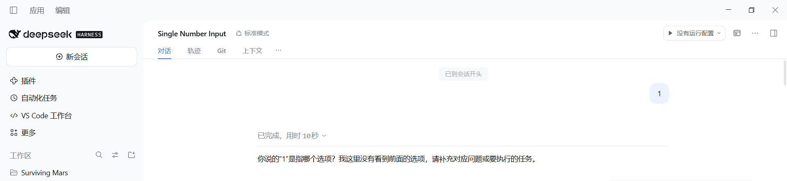

# dsh-quick-run

English | [简体中文](#简体中文)

Run configurations in the DSH conversation header — like VS Code / IDEA. Pick a script, press ▶, watch the output.



## Why another run button

Most run plugins ask you to **save** commands first (add a config, name it, pick a scope). `dsh-quick-run` does the opposite: it **reads what your project already has**.

- `package.json` → every `scripts` entry, launched as `npm run <name>`
- project root → every `*.ps1`, `*.bat`, `*.cmd`, `*.sh` (`.ps1` runs through `powershell -NoProfile -ExecutionPolicy Bypass -File`, the others through `cmd.exe`)
- optional `.dsh-quick-run.json` at the project root, only when you want to pin something down

No configuration file is required. If a project has no scripts, the widget says so instead of showing invented entries.

## Install

```bash
dsh plugin --profile web add github:jiaowoCheung/dsh-quick-run
```

Or install the local directory from **Plugins → Add plugin**.

The widget appears in the Session header, in the utilities cluster before the `…` menu. It reads the **session's working directory**, so each session runs the scripts of the project it is working in.

## Usage

| Control | What it does |
| --- | --- |
| `▶` | Run the selected configuration (re-attaches if that one is already running) |
| `▾` | Pick a configuration, view the running one, edit, refresh, or reset to auto-discovery |
| `■` | Stop the run — the whole process tree (`taskkill /T /F` on Windows) |
| output panel | Live output, status, exit code and duration; auto-scrolls until you scroll up |

Output never goes into the conversation log: it is fetched by polling the host over the same-origin HTTP route, so nothing is appended to the transcript and no command is executed through the chat.

## `.dsh-quick-run.json`

Only needed when you want to add, rename or override configurations:

```json
{
  "configs": [
    { "name": "Run client", "command": "gradlew.bat runClient" },
    { "name": "Serve", "command": "npm run serve", "cwd": "." },
    { "name": "PowerShell", "script": "scripts/build.ps1" }
  ]
}
```

| Field | Meaning |
| --- | --- |
| `name` | Label shown in the dropdown |
| `command` | Command line, run through `cmd.exe /d /s /c` |
| `script` | Script file relative to the project root |
| `program` + `args` | Run an executable directly |
| `cwd` | Working directory relative to the project root |
| `env` | Extra environment variables |
| `includeDiscovered` | `false` disables the automatic script discovery |

## Limits

- Server-side output buffer: 200 KB per run; client-side display cap: 400 KB.
- Finished runs are kept for 10 minutes; at most 20 runs are tracked.
- Windows-oriented process handling (`cmd.exe`, `taskkill`); on other platforms, `command` strings are passed to the default shell.

## Notes

- No `@deepseek-ai/*` runtime dependency: the client half uses React from the host's module table and draws its own controls, so a harness change cannot blank out the slot.
- The host half registers one `webServer` prefix route (`/dsh-quick-run/api`) and checks the browser session on every request.

MIT © jiaowoCheung

---

## 简体中文

# dsh-quick-run

DSH 会话头部的运行配置控件——像 VS Code / IDEA 那样，选一个脚本，点 ▶，看输出。


### 和其他运行插件的区别

大多数运行插件要求你**先保存命令**（新建配置、起名、选作用域）。这个插件反过来：**读项目里已经有的东西**。

- `package.json` → 每个 `scripts` 条目，按 `npm run <名字>` 启动
- 项目根目录 → 每个 `*.ps1` / `*.bat` / `*.cmd` / `*.sh`（`.ps1` 走 `powershell -NoProfile -ExecutionPolicy Bypass -File`，其余走 `cmd.exe`）
- 可选的 `.dsh-quick-run.json`（只在你想固定某些配置时才需要）

**不需要任何配置文件**。项目里没有脚本时，控件会如实说没有，而不是编出几条来。

### 安装

```bash
dsh plugin --profile web add github:jiaowoCheung/dsh-quick-run
```

也可以在 **插件 → 添加插件** 里装本地目录。

控件出现在会话标题行的工具区（`…` 菜单左边），运行目录取**当前会话的工作目录**，所以每个会话跑的都是它正在做的那个项目的脚本。

### 用法

| 控件 | 作用 |
| --- | --- |
| `▶` | 运行选中的配置（同一条已在运行就直接接回它） |
| `▾` | 选配置、查看正在运行的、编辑配置、刷新、重置为自动发现 |
| `■` | 停止——整棵进程树一起杀（Windows 上 `taskkill /T /F`） |
| 输出面板 | 实时输出、状态、退出码与耗时；你往上滚之前自动贴底 |

输出**不写进会话日志**：客户端通过同源 HTTP 轮询 host 半边，所以既不会往对话记录里追加东西，也不会借聊天执行命令。

### `.dsh-quick-run.json`

只有在需要新增、改名或覆盖配置时才用：

```json
{
  "configs": [
    { "name": "运行客户端", "command": "gradlew.bat runClient" },
    { "name": "启动服务", "command": "npm run serve", "cwd": "." },
    { "name": "构建脚本", "script": "scripts/build.ps1" }
  ]
}
```

| 字段 | 含义 |
| --- | --- |
| `name` | 下拉里显示的名字 |
| `command` | 命令行，经 `cmd.exe /d /s /c` 执行 |
| `script` | 相对项目根目录的脚本文件 |
| `program` + `args` | 直接运行一个可执行文件 |
| `cwd` | 相对项目根目录的工作目录 |
| `env` | 额外的环境变量 |
| `includeDiscovered` | `false` 关掉自动发现 |

### 限制

- 服务端每次运行缓冲 200 KB 输出，客户端最多显示 400 KB。
- 运行结束后保留 10 分钟；最多同时记录 20 次运行。
- 进程处理偏 Windows（`cmd.exe`、`taskkill`）；其他平台把 `command` 交给默认 shell。

### 说明

- 不依赖任何 `@deepseek-ai/*` 运行时包：客户端半边用宿主模块表里的 React、自己画控件，harness 升级不会让整个座位变空白。
- Host 半边只注册一条 `webServer` 前缀路由（`/dsh-quick-run/api`），每个请求都校验浏览器会话。

MIT © jiaowoCheung
